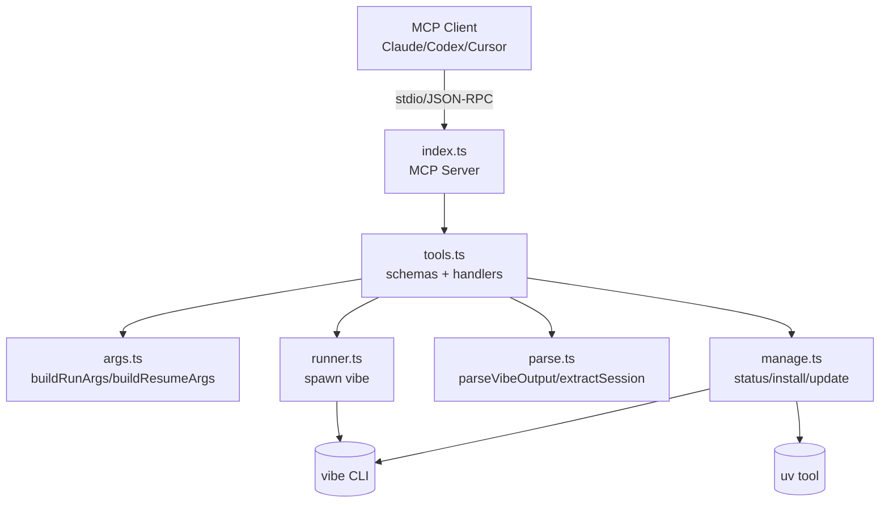
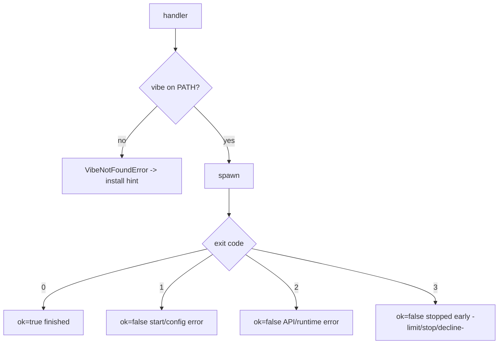

# Design: mistral-vibe-mcp

## Overview

A small, dependency-light TypeScript MCP stdio server that shells out to the Mistral Vibe
CLI. The design keeps the "impure" process spawning isolated behind a thin runner so the
"pure" logic (argument building, output parsing) is fully unit-testable without the Vibe
binary.

Decisions recorded:
- **Language/runtime**: TypeScript, Node 20+, ESM. (BRIEF preference.)
- **MCP library**: `@modelcontextprotocol/sdk` with `StdioServerTransport`.
- **Validation**: `zod` for tool input schemas (converted to JSON schema for MCP).
- **License**: MIT (clean-room, not a GPL fork).
- **Spawning**: Node `child_process.spawn`, args as an array (no shell string interpolation) to avoid injection.
- **Output**: always request `--output json`; parse defensively (Vibe may emit a JSON object, or text we wrap).
- **Safety default**: `auto_approve` defaults to false; the agent default is Vibe's own default unless specified.
- Open question (recorded, not blocking): exact JSON shape of `--output json` across Vibe versions is not pinned by docs, so the parser is tolerant — it tries JSON.parse, falls back to raw text, and scrapes a session id heuristically.

## Architecture



### Module layout
- `src/index.ts` — entrypoint: build server, register tools, connect stdio transport.
- `src/tools.ts` — tool definitions (name, description, zod schema) + dispatch handlers.
- `src/args.ts` — pure functions building `vibe` argv arrays from validated inputs.
- `src/parse.ts` — pure functions parsing Vibe stdout and extracting session id / cost summary.
- `src/runner.ts` — thin `spawn` wrapper returning `{ code, stdout, stderr }`; detects ENOENT.
- `src/manage.ts` — status/install/update helpers.
- `src/types.ts` — shared types.

## Components and Interfaces

### args.ts (pure)
```ts
interface RunInput {
  prompt: string;
  project_dir?: string;
  max_turns?: number;
  max_tokens?: number;
  max_price?: number;
  time_limit?: number;
  model?: string;
  agent?: "ask" | "accept-edits" | "smart-approve" | "auto-approve";
  enabled_tools?: string[];
  disabled_tools?: string[];
  auto_approve?: boolean;
  worktree?: string | boolean;
  trust?: boolean;
  output?: "json" | "text" | "streaming"; // default json
}
function buildRunArgs(input: RunInput): string[];

interface ResumeInput extends Omit<RunInput, "prompt"> {
  prompt?: string;         // optional follow-up prompt
  session_id?: string;
  continue?: boolean;
}
function buildResumeArgs(input: ResumeInput): string[];
```
Rules: `--prompt` first when present, `--output json` always unless overridden, repeatable
flags expanded per value, booleans emit the flag only when true, `--worktree` emits a name
arg only when a string is given.

### parse.ts (pure)
```ts
interface VibeResult {
  json: unknown | null;     // parsed JSON when available
  text: string;             // raw stdout
  sessionId: string | null; // best-effort
  summary: { cost?: number; turns?: number; tokens?: number } | null;
}
function parseVibeOutput(stdout: string): VibeResult;
function extractSessionId(text: string): string | null; // regex: session ids / "session: XXXX"
```

### runner.ts (impure, isolated)
```ts
interface RunResult { code: number; stdout: string; stderr: string; timedOut: boolean; }
function runVibe(args: string[], opts: { cwd: string; env?: NodeJS.ProcessEnv; bin?: string }): Promise<RunResult>;
```
ENOENT → throws `VibeNotFoundError` with install hint. Exit code mapping is applied by the
tool handler using the documented codes (0 ok, 1 config, 2 runtime, 3 stopped early).

### tools.ts
Registers three tools; each handler validates with zod, builds args, runs, parses, and
returns an MCP `content` array (a JSON text block + a short human summary).

## Data Models

Tool result shape returned to MCP clients (as a JSON text block):
```json
{
  "ok": true,
  "exitCode": 0,
  "exitClass": "finished",
  "sessionId": "abc123",
  "summary": { "cost": 0.012, "turns": 3 },
  "output": { "...": "parsed vibe json or null" },
  "raw": "stdout text (truncated in human summary)"
}
```

## Error Handling


- All handlers catch and convert errors into MCP error results (`isError: true`) with a readable message; the process never crashes on a single bad call.
- No secrets are echoed; env is passed through unchanged.

## Testing Strategy

- **Unit (vitest)**, no network, no Vibe binary:
  - `args.test.ts`: buildRunArgs / buildResumeArgs flag mapping, defaults, repeatables, boolean handling, resume vs continue precedence.
  - `parse.test.ts`: JSON output, text fallback, session-id extraction, cost summary extraction.
- Runner/manage are integration-only; covered by a mockable `bin` param but not required to pass CI.
- CI: GitHub Actions, Node 20, `npm ci && npm run build && npm test`.

## Agent Skills (add-on)

The repo also ships Agent Skills under `skills/<name>/SKILL.md` (vercel-labs `npx skills`
discovery path): `mistral-vibe` (umbrella), `vibe-run`, `vibe-resume`, `vibe-manage`. Each has
YAML frontmatter (`name` matching the directory, `description` of what/when) and short,
actionable instructions for driving THIS server's MCP tools — not a copy of Vibe docs.
