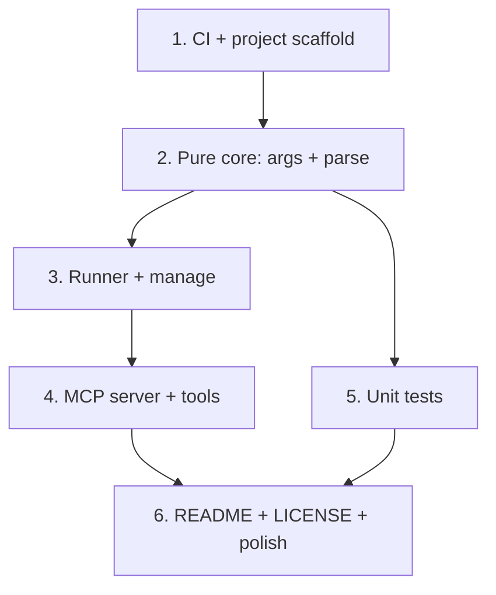

# Implementation Plan: mistral-vibe-mcp

## Overview

Build a TypeScript MCP stdio server wrapping the Mistral Vibe CLI. Pure core (argv builders,
output parsing) is isolated from the process layer so it is fully unit-testable without the
Vibe binary. CI is set up first.

## Task Dependency Graph



```json
{
  "waves": [
    { "wave": 1, "tasks": ["1"] },
    { "wave": 2, "tasks": ["2"] },
    { "wave": 3, "tasks": ["3", "5"] },
    { "wave": 4, "tasks": ["4"] },
    { "wave": 5, "tasks": ["6"] }
  ]
}
```

## Tasks

- [x] 1. Project scaffold & CI
  - package.json (ESM, Node 20+, scripts: build/test/start), tsconfig.json, .gitignore, .github/workflows/ci.yml
  - _Requirements: 1.3, 6.3, 6.4_

- [x] 2. Pure core modules
  - [x] 2.1 `src/types.ts` shared types + exit classification
  - [x] 2.2 `src/args.ts` buildRunArgs / buildResumeArgs
  - [x] 2.3 `src/parse.ts` parseVibeOutput / extractSessionId / summary
  - _Requirements: 2.2, 2.3, 3.1, 3.2, 3.3, 3.5, 5.1_

- [x] 3. Process layer
  - [x] 3.1 `src/runner.ts` spawn wrapper + VibeNotFoundError + timeout
  - [x] 3.2 `src/manage.ts` status/install/update
  - _Requirements: 2.5, 2.6, 4.1, 4.2, 4.3, 4.4, 5.2_

- [x] 4. MCP server & tools
  - [x] 4.1 `src/tools.ts` schemas + handlers (vibe_run, vibe_resume, vibe_manage)
  - [x] 4.2 `src/index.ts` stdio server wiring
  - _Requirements: 1.1, 1.2, 1.4, 2.1, 2.4, 2.6, 3.4_

- [x] 5. Unit tests
  - test/args.test.ts, test/parse.test.ts (vitest)
  - _Requirements: 6.1, 6.2_

- [x] 6. Docs & packaging
  - README (tools + MCP client config for Claude Desktop / Codex / Cursor), LICENSE (MIT)
  - _Requirements: 6.4_

## Notes

- Open question (recorded, not blocking): the exact JSON shape of `vibe --output json` is not
  pinned across versions, so `parse.ts` is tolerant (JSON.parse -> last JSON line -> raw text)
  and scrapes the session id heuristically.
- Safe default: `auto_approve` is false unless explicitly set.

- [x] 7. Agent Skills
  - skills/{mistral-vibe,vibe-run,vibe-resume,vibe-manage}/SKILL.md; README "Agent Skills" section
  - _Requirements: 6.4_
